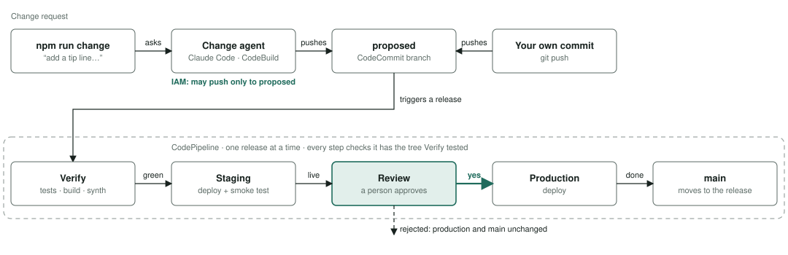

# Design

**The LLM reads; code does the money.** Claude turns screenshots and messy texts into structured terms and bill lines. A deterministic checker (`checker.py`) prices every line against the agreement version in effect on that line's date and shows the arithmetic ("0.5h at $28/hr after 10pm = $14"). Every dollar figure on screen comes from code, so the same bill always gets the same answer, and the explanation is the calculation itself.

**The agent proposes; Jordan decides.** The agent's tools can read records, record a bill as an open draft, and create *proposals*. There is no agent tool that saves terms or approves a bill; a test locks that in. Saving terms and approving bills happen only through API routes the UI calls when Jordan clicks Confirm/Approve in a dialog. Approval re-prices the bill and refuses if the amount differs from what Jordan saw. It also refuses while a terms change for that helper is still pending, so Jordan can't approve against stale terms. Approved bills are locked with a conditional write (`status = open`), and the approval stores a snapshot of the check and the agreement versions used. A second bill for an already-approved period is flagged as a possible duplicate.

**Memory vs. records.** *AgentCore Memory* holds the conversation (short-term events per session) and soft, long-term context across sessions: Jordan's preferences and household facts ("Sam sometimes OKs things by text"), plus session summaries. *DynamoDB* is the system of record: helpers, agreement versions with source quotes and effective dates, bills, approvals, and an audit log of who did what. The agent is told that remembered facts are background and never a source of rates. A remembered "$25 a walk" can never price a bill; only a confirmed agreement version can. Records need to be exact, versioned and auditable. Memory needs to be helpful and fuzzy.

**When inputs disagree.** Each agreement version is a complete snapshot from an effective date, so history is never overwritten. The newer *accepted* written message beats older messages and Jordan's recollection (Theo's $28 text supersedes the notes' $25). The proposal lists the disagreement so Jordan sees it before saving. Terms from Jordan's notes alone are marked "from your notes, not in writing". A one-sided announcement Jordan never accepted isn't treated as agreed. A charge nobody agreed to (Priya's $40 fee "Sam said was fine") is never auto-accepted: it becomes a line Jordan must decide (pay as billed, or don't pay). A bill whose total doesn't equal its lines is flagged, and the app pays by the lines, not the stated total. Before saving, a proposal previews its effect on open bills ("Lupe's September bill would be checked at $800 instead of $780").

**Calls I made on ambiguity.** "Starting the 15th" (sent Aug 28) means Sep 15. Day multipliers ("Sundays time and a half") apply to the day the shift starts. Whether that multiplier stacks on the late rate was never agreed, so a Sunday-late line is flagged *ambiguous* instead of guessed. Undated quantity lines (Theo's "18 walks") can't be priced if rates changed mid-period. Weekday and holiday counts are a soft sanity check ("20 billed vs. 21 possible weekdays, excluding Labor Day"), not an error.

**Agent shape.** One Strands agent (Claude Opus 4.6 on Bedrock; the same code runs Opus 5.5 on Bedrock's Messages-API endpoint) with 7 tools. Screenshots are transcribed verbatim at upload by a separate call, so the conversation and memory only ever hold text, and Jordan can compare the transcript with the original. Documents are fenced as `<document>` data and the prompt forbids following instructions inside them; a prompt-injected bill can at worst create a proposal Jordan sees. Chat turns run as async jobs (API Gateway's 30s limit) with visible progress steps. The system prompt is frozen per conversation (the date rides on each message), and on the Messages-API path earlier turns' thinking blocks are dropped before each call, so restored memory can't invalidate the model's history check.

**Infrastructure.** One CDK stack: Cognito (single admin-created user, password in Secrets Manager), API Gateway HTTP API with a JWT authorizer on every route plus throttling, a Python Lambda (bundled with uv, no Docker), DynamoDB (on-demand, PITR), private S3 buckets, CloudFront for the SPA, and AgentCore Memory with semantic/preference/summary strategies. Nothing is account- or region-specific; everything is destroyed on teardown.

**Releasing changes.** An optional pipeline stack closes the loop inside AWS. `npm run change -- "…"` runs Claude Code in CodeBuild; its IAM role can push only to the `proposed` branch. CodePipeline then verifies, deploys staging, waits for a person to approve, and only then deploys production and moves `main`. Each stage checks it has the exact tree Verify tested.

**Known failure modes.** Transcription or extraction can misread a screenshot. Mitigations: the original image sits next to its transcript, every term carries a source quote, and Jordan confirms terms before they're used. A misread line is fixed in the bill's line editor (date, times, amount, which term it maps to); the checker re-prices on save, the edit is audited, and approved bills refuse edits. Schemas cover hourly/tiered/multiplier, flat packages with overtime, and per-unit pricing; anything else (mileage, percentage tips) becomes "needs your decision" rather than a wrong number. Bedrock's Messages-API endpoint has no published resource ARN format yet, so `bedrock-mantle:CreateInference` is granted on `*`.

**Deliberately left out.** Real payments, notifications, multiple users or households, editing approved bills, an "undo" for confirmed terms (a new version supersedes instead).
